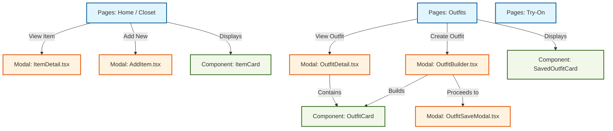

# Web App Source (`src/transport/web/app/src`)

This directory contains the React single-page application (SPA) for the Vastra.io web client.

## Component Architecture & Modal Wiring

The application relies heavily on a modal-based architecture for data entry and detailed views. The graph below illustrates how the main pages route to specific modals, and which components those modals use internally.

### Legend
*   **Pages (Blue):** The main routing destinations (`/`, `/outfits`, `/try-on`).
*   **Modals (Orange):** Overlay interfaces for specific workflows (adding an item, viewing an outfit).
*   **Components/Cards (Green):** Reusable UI elements that display data (representing a single item or an entire outfit).

## Key Components (`src/components/`)

### 1. `AuthImage` (`AuthImage.tsx`)
**Purpose:** Securely loads images from the backend API.
**Function:** Because the app is often served over HTTP on local networks (like a phone connecting to a laptop's IP), standard cookie-based authentication for images can fail. `AuthImage` intercepts the standard `` behavior, manually fetches the image using the user's `Bearer` token in the request headers, converts the result into a local memory Blob (`URL.createObjectURL`), and renders it. This ensures images always load regardless of the transport environment.

### 2. `ItemCard` (`ItemCard.tsx`)
**Purpose:** The standard display card for a single garment.
**Function:** Used primarily in the Closet grid. It enforces a consistent aspect ratio (`aspect-[4/5]`), securely loads the garment image via `AuthImage`, and manages interactive states (like being highlighted when selected for outfit building or bulk actions).

### 3. `OutfitCard` vs `SavedOutfitCard`
*   **`OutfitCard.tsx`**: Displays an *individual item* inside a larger outfit context (e.g., a shirt currently being used inside the `OutfitBuilder` modal).
*   **`SavedOutfitCard.tsx`**: Displays an *entire, finalized outfit collection* as a single cohesive card on the main Outfits gallery page.

### 4. Primitive UI Components (`src/components/ui/`)
**Purpose:** Reusable, isolated building blocks (e.g., `Button.tsx`, `Input.tsx`, `Badge.tsx`).
**Function:** To prevent complex TSX files from becoming bloated with repetitive strings of Tailwind `className` attributes, atomic UI elements are extracted here. Instead of writing raw HTML `<button class="...">` everywhere, pages import `<Button>` to enforce design consistency and clean up the codebase architecture.
